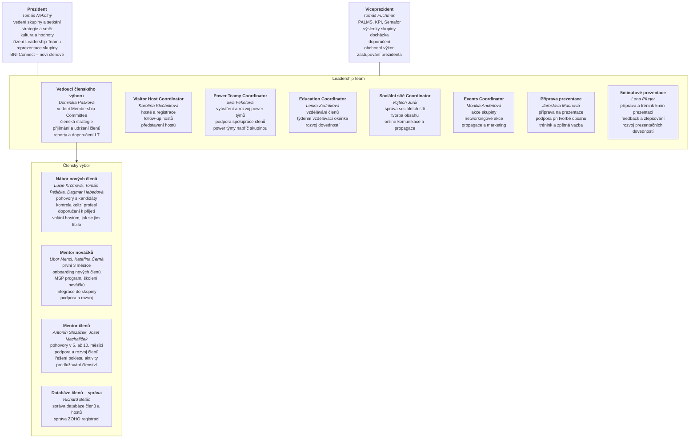

# Vedení chapteru BNI Pilsner Fountains

Stav k 12. 10. 2026, podle prezentace vedení („pavouk“). Struktura se ještě bude měnit, tenhle soubor se udržuje průběžně.

Jména jsou tu se souhlasem prezidenta chapteru (12. 10. 2026). Kontaktní údaje sem nepatří, repo je veřejné.

## Schéma

## Rozdíly proti pravidlům BNI a stránce `/pravidla/role`

Tohle je k diskusi, na webu se zatím nic nemění.

| Téma | U nás (pavouk) | Manuál BNI a stránka rolí |
|---|---|---|
| Kdo vede členský výbor | samostatná role „Vedoucí členského výboru“ | viceprezident |
| Oblasti členského výboru | nábor nových členů, mentor nováčků, mentor členů, databáze členů | posouzení přihlášek, růst chapteru, zapojení členů, vztahy mezi členy |
| Role v Leadership teamu | navíc power teamy, sociální sítě, events, příprava prezentací, 5minutové prezentace | manuál tyto role nemá |
| Vzdělávání | „týdenní vzdělávací okénka“ | stejný termín jako na stránkách série |

## Historie

- 2026-10-12: první verze podle prezentace vedení, včetně obsazení rolí.
